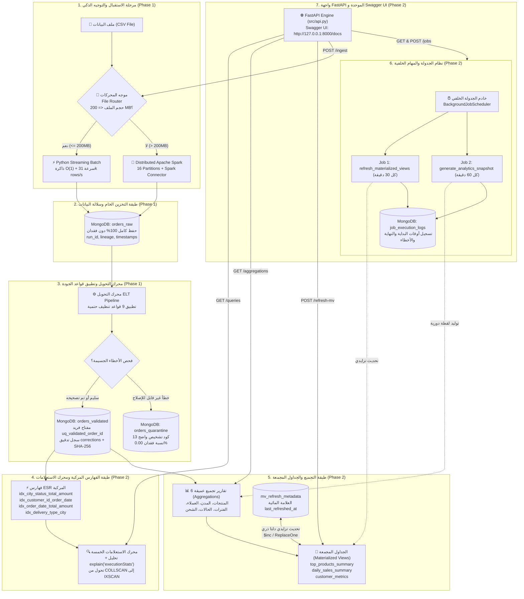
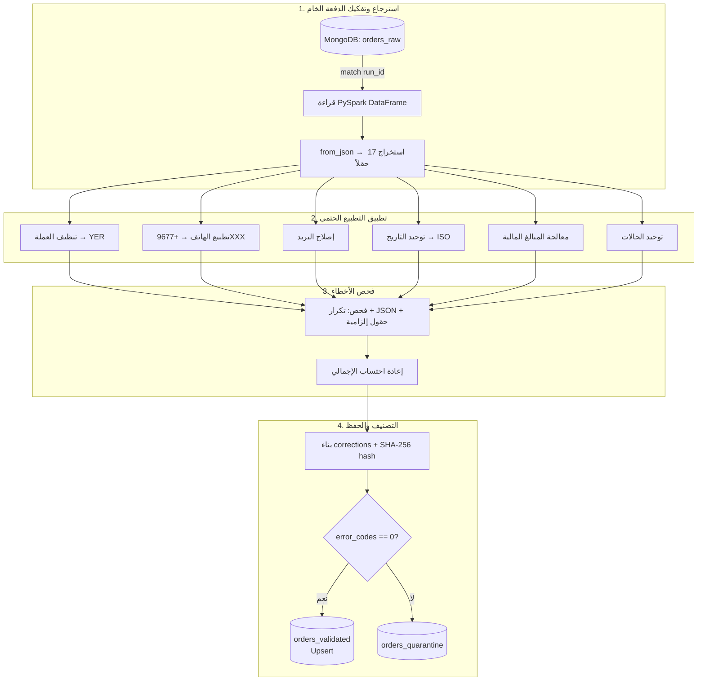
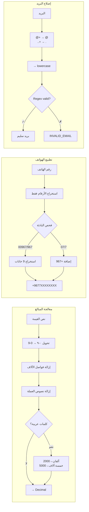
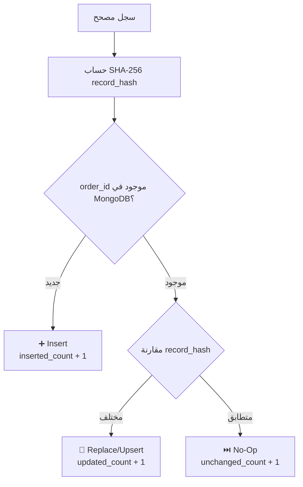

# 🚀 خط البيانات والتحليلات الضخمة الهجين المتكامل — المرحلتان الأولى والثانية
### *Enterprise Hybrid Big Data Pipeline & Analytics Engine: Ingestion (Phase 1) + Analytics & Serving (Phase 2)*
### *Alrazi University — كلية الحاسوب وتقنية المعلومات — قسم الذكاء الاصطناعي — المستوى الرابع*
### **الطالب:** Omar-Alabdali

[](tests/)
[](reports/results.json)
[](reports/phase2_evidence/)
[](#-13-ربط-معايير-التقييم-الرسمية-بالتنفيذ-الفعلي)
[](https://python.org)
[](https://spark.apache.org)
[](https://mongodb.com)
[](http://127.0.0.1:8000/docs)

---

## 📑 جدول المحتويات الشامل

| # | القسم الرئيسي | المحتوى الفني والتفاصيل |
|:---:|---|---|
| 1 | [📌 الملخص التنفيذي وفكرة المشروع](#-1-الملخص-التنفيذي-وفكرة-المشروع) | الفكرة العامة، نمط ELT، والتكامل بين المرحلتين الأولى والثانية |
| 2 | [🏗️ المعمارية الهندسية الشاملة للمشروع](#️-2-المعمارية-الهندسية-الشاملة-للمشروع) | مخطط Mermaid الشامل: تدفق البيانات من الاستلام إلى واجهة الخدمة والتحليلات |
| 3 | [✨ 3. الميزات التقنية للمرحلة الأولى: هندسة وتدفق البيانات (18 درجة)](#-3-الميزات-التقنية-للمرحلة-الأولى-هندسة-وتدفق-البيانات-18-درجة) | الموجه الذكي، طبقة Raw، قواعد الجودة الـ 9، سجل التدقيق، العزل، واللاتكرارية |
| 4 | [🚀 4. الميزات التقنية للمرحلة الثانية: التحليلات المتقدمة والخدمة (7 درجات)](#-4-الميزات-التقنية-للمرحلة-الثانية-التحليلات-المتقدمة-والخدمة-7-درجات) | استراتيجية الفهارس ESR، مقارنة Explain، الـ 6 Aggregations، التحديث التزايدي، والـ API |
| 5 | [📂 5. هيكل المشروع وشجرة الملفات الموحدة](#-5-هيكل-المشروع-وشجرة-الملفات-الموحدة) | تفصيل مسارات الأكواد والاختبارات والأدلة لكلتا المرحلتين |
| 6 | [📋 6. المتطلبات الأساسية وإعداد البيئة والتثبيت](#-6-المتطلبات-الأساسية-وإعداد-البيئة-والتثبيت) | إعداد Python و MongoDB و Java و Spark والمتغيرات البيئية النظيفة |
| 7 | [⚡ 7. دليل التشغيل السريع الموحد](#-7-دليل-التشغيل-السريع-الموحد) | أوامر تنفيذ خط البيانات، المعايير، الاختبارات، وخادم FastAPI بخطوة واحدة |
| 8 | [📊 8. مخرجات التشغيل الفعلية وسجل الإثبات الكامل](#-8-مخرجات-التشغيل-الفعلية-وسجل-الإثبات-الكامل) | أدلة رقمية حية لكل معيار من معايير Phase 1 و Phase 2 |
| 9 | [✅ 9. حزمة الاختبارات الآلية والتحقق (15 Passed)](#-9-حزمة-الاختبارات-الآلية-والتحقق-15-passed) | تفصيل الاختبارات في PyTest |
| 10 | [🔥 10. مسار المعالجة الموزعة Spark Standalone (Path A)](#-10-مسار-المعالجة-الموزعة-spark-standalone-path-a) | تشغيل وإثبات العنقود المحلي (Master & Worker) وتوزيع الأحمال |
| 11 | [📐 11. المخططات المعمارية ومخططات التدفق](#-11-المخططات-المعمارية-ومخططات-التدفق) | مخططات Mermaid لمحرك التحويل، قواعد الجودة، دورة اللاتكرارية، والكلاسات |
| 12 | [⚙️ 12. جدول متغيرات البيئة وإعدادات الأمان](#️-12-جدول-متغيرات-البيئة-وإعدادات-الأمان) | جدول الإعدادات وتأمين المفاتيح والاتصال مع نموذج `example.env` |
| 13 | [🎯 13. ربط معايير التقييم الرسمية بالتنفيذ الفعلي](#-13-ربط-معايير-التقييم-الرسمية-بالتنفيذ-الفعلي) | جداول التقييم الرسمية وربطها بالتنفيذ |
| 14 | [🧰 14. التقنيات والمكتبات المستخدمة](#-14-التقنيات-والمكتبات-المستخدمة) | جدول تفصيلي للمكونات البرمجية والأطر المستخدمة في النظام |
| 15 | [📸 15. لقطات الإثبات والتشغيل الفعلي لكافة المراحل](#-15-لقطات-الإثبات-والتشغيل-الفعلي-لكافة-المراحل) | معرض الصور واللقطات الحية عالية الدقة لعمليات التشغيل |
| 16 | [❓ 16. استكشاف الأخطاء وحلها (Troubleshooting)](#-16-استكشاف-الأخطاء-وحلها-troubleshooting) | الحلول الفورية للمشاكل الشائعة في البيئة وقواعد البيانات |

---

## 📌 1. الملخص التنفيذي وفكرة المشروع

تم تصميم وتطوير هذا المشروع المؤسسي المتكامل كحل شامل لمعالجة مجموعات البيانات الضخمة غير المنظمة لطلبات المتاجر الإلكترونية (E-Commerce Orders Dataset)، وفقاً لمتطلبات **المشروع النهائي لمقرر البيانات الضخمة (القسم العملي) — المستوى الرابع، تخصص الذكاء الاصطناعي — Alrazi University**.

**الطالب:** Omar-Alabdali

المشروع يغطي دورة حياة البيانات الضخمة بالكامل من خلال مرحلتين رئيسيتين تعملان معاً كمنظومة متماسكة:

1. **المرحلة الأولى (Phase 1 — 18.0 درجة): هندسة وتدفق البيانات وجودتها (ELT Hybrid Pipeline):**
   - **موجه المحركات الديناميكي الذكي (Dynamic File Router):** يفحص حجم ملفات الإدخال تلقائياً؛ فإذا كان حجم الملف $\le 200\text{ MB}$ يُوجّه إلى محرك البايثون التدفقي الخفيف، وإذا كان $> 200\text{ MB}$ يُوجّه إلى محرك Apache Spark الموزع.
   - **التحميل التدفقي بالبايثون (Streaming Python Batch):** معالجة تدفقية بسعة ذاكرة ثابتة $O(1)$ باستخدام `csv.DictReader` ودفعات `insert_many` لتحقيق سرعات تتجاوز 31,000 سجل/ثانية.
   - **المعالجة المتوازية بـ PySpark (Distributed Partitions):** قراءة سريعة بمخطط ثابت (`Fixed Schema`) وتوزيع البيانات على 16 تقسيم وكتابتها مباشرة عبر `MongoDB Spark Connector`.
   - **حفظ البيانات الخام (Zero-Loss Raw Layer):** إيداع السجلات الأصلية دون فقدان في `orders_raw` مع توثيق سلالة البيانات (`run_id`, `source_file`, `source_row_number`, `ingested_at`, `engine_used`).
   - **محرك قواعد الجودة الـ 9 الحتمي (Automated Quality Engine):** تنظيف شامل للأرقام المشرقية، العملات، الكلمات، الهواتف، البريد، التواريخ، الحالات، وإعادة احتساب الإجماليات، مع فرز البيانات إلى طبقة السجلات السليمة والمصححة `orders_validated` (مع مصفوفة تدقيق `corrections`) أو عزل التالف في `orders_quarantine` مع 13 كود تشخيص واضح ونسبة فقدان 0.00%.
   - **اللاتكرارية والتحديث الذكي (Idempotency & Upsert):** ضمان اتساق السجلات عبر مفتاح العمل الثابت `order_id` وتجزئة التشفير `SHA-256 (record_hash)` لمنع أي تكرار عند إعادة التشغيل.

2. **المرحلة الثانية (Phase 2 — 7.0 درجات): التحليلات المتقدمة والفهارس والخدمة (Analytics & Serving Engine):**
   - **طبقة الفهارس المركبة وقاعدة ESR (Indexing Strategy):** إنشاء 4 فهارس مركبة مصممة بدقة حسب مبدأ `Equality, Sort, Range` لخدمة الاستعلامات الحقيقية.
   - **تحليل إحصائيات الأداء ومقارنة Explain:** تنفيذ `explain("executionStats")` قبل وبعد الفهارس لـ 3 استعلامات وإثبات الانتقال من المسح الكامل للجدول `COLLSCAN + SORT` إلى المسح الفهرسي المباشر `IXSCAN + FETCH` مع خفض الوثائق المفحوصة بنسبة تصل إلى **99.8%**.
   - **تقارير التجميع المستقلة (6 Aggregation Pipelines):** ستة تقارير تجميعية عميقة تشمل أفضل المنتجات مبيعاً وإيراداً (`top_products`)، المبيعات حسب المدن (`sales_by_city`)، القيمة الدائمة للعملاء (`top_customers`)، التسلسل الزمني للمبيعات (`sales_by_period`)، توزيع حالات الطلب والدفع (`orders_by_status`)، وأداء شركات الشحن والتوصيل (`delivery_performance`).
   - **الجداول المجمعة والتحديث التزايدي الحقيقي (Materialized Views with Delta Watermark):** بناء 3 جداول مجمعة (`top_products_summary`، `daily_sales_summary`، و `customer_metrics`) مع ميكانيكية تحديث تزايدي ذكية تعتمد على العلامة المائية (`last_refreshed_at`) ومعاملات التحديث الذري `$inc`.
   - **المهام المجدولة وسجلات التدقيق (Scheduled Jobs & Audit Logs):** خادم جدولة خلفي (`BackgroundJobScheduler`) يدير مهمتين دوريتين لتحديث الجداول المجمعة وأرشفة اللقطات التحليلية، مع إمكانية التشغيل اليدوي وتسجيل كافة تفاصيل البداية والنهاية والأخطاء داخل MongoDB.
   - **واجهة FastAPI الموحدة وعقود الـ API:** تطبيق ويب عصري يوفر 10 Endpoints موثقة تفاعلياً عبر Swagger UI (`/docs`)، مع إعادة استخدام موجه ومحرك المرحلة الأولى في `/ingest` مباشرة دون تكرار أي كود.

---

## 🏗️ 2. المعمارية الهندسية الشاملة للمشروع

يُوضح المخطط التالي تدفق البيانات المتكامل من لحظة استلام الملف وتوجيهه حتى مرحلة التحليلات المتقدمة والخدمة عبر واجهة التطبيقات البرمجية (API):



---

## ✨ 3. الميزات التقنية للمرحلة الأولى: هندسة وتدفق البيانات (18 درجة)

### 1️⃣ موجه المحركات الديناميكي (`src/file_router.py`)

- يفحص حجم الملف بالميجابايت تلقائياً مقابل الحد الفاصل `SMALL_FILE_THRESHOLD_MB` (افتراضياً 200 MB).
- يولد `run_id` فريد من نوع UUID لكل عملية تشغيل، ويوثق مسار الملف والمحرك المختار مع التبرير المنطقي.
- **التبرير المعماري للحد 200 MB:** الملفات الصغيرة تستهلك وقتاً أطول في Spark بسبب عبء تهيئة JVM وإنشاء جلسة SparkSession، بينما يعالجها Python Batch بسرعة فائقة وذاكرة ثابتة. الملفات الأكبر من 200 MB تستفيد من قدرة Spark على توزيع الأعباء على أنوية المعالجة.

### 2️⃣ طبقة التخزين الخام وميثاق السلالة (`orders_raw`)

- لا يُسقط أي سجل مشوه — يتم حفظ النص الأصلي كـ JSON داخل الحقل `raw_record`.
- توثيق سلالة البيانات (Lineage): حفظ `run_id`, `source_file`, `source_row_number`, `ingested_at`, و `engine_used` مع كل وثيقة.

### 3️⃣ قواعد التحويل والتنظيف الحتمية الـ 9 (`src/quality_rules.py`)

| # | اسم القاعدة | المشكلة المعالجة | مثال على التحويل | رمز القاعدة |
|:---:|---|---|---|---|
| 1 | **Arabic Digits** | تحويل الأرقام المشرقية `٠-٩` | `٥٠٠٠` → `5000` | `MONEY_NORMALIZE` |
| 2 | **Currency Standardize** | توحيد العملة وإزالة النصوص | `12,500 ريال يمني` → `12500` + `YER` | `CURRENCY_STANDARDIZE` |
| 3 | **Thousands Separators** | إزالة الفواصل والرموز | `125,000.00` → `125000.00` | `MONEY_NORMALIZE` |
| 4 | **Word Prices** | أسعار بالكلمات العربية | `خمسة آلاف` → `5000` | `MONEY_NORMALIZE` |
| 5 | **Phone Normalize** | توحيد الهواتف اليمنية | `00967771234567` → `+967771234567` | `PHONE_NORMALIZE` |
| 6 | **Email Repair** | إصلاح الرموز المكررة | `user@@gmail..com` → `user@gmail.com` | `EMAIL_REPEATED_SYMBOLS` |
| 7 | **Date Standardize** | توحيد التواريخ | `25/08/2026` → `2026-08-25T00:00:00` | `DATE_STANDARDIZE` |
| 8 | **Status Synonyms** | توحيد مرادفات الحالات | `مدفوع` → `تم الدفع` | `STATUS_STANDARDIZE` |
| 9 | **Total Recalculation** | إعادة احتساب الإجمالي | Total = Σ Items + Delivery | `TOTAL_RECALCULATE` |

### 4️⃣ سجل التدقيق التفصيلي (`corrections`)

كل وثيقة جرى تعديلها تحمل الحالة `quality_status: "corrected"` مع مصفوفة تدقيق شاملة:

```json
{
  "order_id": "ORD-12345",
  "quality_status": "corrected",
  "corrections": [
    {"field": "customer_email", "original_value": "user@@mail..com", "corrected_value": "user@mail.com", "rule_code": "EMAIL_REPEATED_SYMBOLS"},
    {"field": "customer_phone", "original_value": "٠٠٩٦٧٧٧١٢٣٤٥٦٧", "corrected_value": "+967771234567", "rule_code": "PHONE_NORMALIZE"}
  ]
}
```

### 5️⃣ طبقة العزل الذكي وتصنيف الأخطاء (`orders_quarantine`)

السجلات التالفة التي تفتقر للمفاتيح الأساسية تُفرز إلى مجموعة العزل مع ذكر أكواد التشخيص:

| رمز الخطأ التشخيصي | سبب العزل الفني |
|---|---|
| `MISSING_ORDER_ID` | معرف الطلب الأساسي مفقود أو فارغ |
| `MISSING_CUSTOMER_ID` | معرف العميل غير موجود |
| `INVALID_IMPOSSIBLE_DATE` | تاريخ تقويمي مستحيل (مثل 31 فبراير) |
| `CORRUPTED_ITEMS_JSON` | نص JSON تالف ومكسور لا يمكن تفكيكه |
| `EMPTY_ITEMS` | قائمة عناصر الطلب فارغة تماماً |
| `UNKNOWN_PRICE` | سعر مفقود أو نص عشوائي غير معرف |
| `AMBIGUOUS_NEGATIVE_VALUE` | مبالغ أو أسعار سالبة غير منطقية |
| `DUPLICATE_ORDER_ID` | معرف طلب مكرر داخل نفس الدفعة الواحدة |
| `MULTIPLE_CONFLICTING_ERRORS` | تواجد أكثر من خطأ جسيم في السجل الواحد |

### 6️⃣ اللاتكرارية والتحديث الذكي (Idempotency & Upsert)

- **مفتاح فريد ومفهرس:** إنشاء فهرس فريد `uq_validated_order_id` على الحقل `order_id`.
- **مقارنة تجزئة SHA-256:** حساب الهاش المشفر للسجل `record_hash`؛ إذا طابق الموجود يُهمل السجل مع زيادة عداد `unchanged_count`، وإذا اختلف يتم تحديث السجل في مكانه مع زيادة عداد `updated_count`.
- **معادلة اتساق الدفعة:** يتحقق النظام برمجياً من صحة المعادلة الحتمية:
  $$\text{raw\_count} = \text{valid\_count} + \text{corrected\_count} + \text{quarantine\_count}$$

---

## 🚀 4. الميزات التقنية للمرحلة الثانية: التحليلات المتقدمة والخدمة (7 درجات)

### 1️⃣ استراتيجية الفهارس المركبة وقاعدة ESR (`src/queries.py`)

تم بناء 4 فهارس مركبة مصممة بدقة استناداً لقاعدة **Equality, Sort, Range (ESR)**:

- **`idx_city_status_total_amount` (`city: 1, status: 1, total_amount: -1`):** تصفية المدينة والحالة بالمساواة (`Equality`)، ثم فرز المبلغ الإجمالي تنازلياً (`Sort`) مباشرة عبر B-Tree.
- **`idx_customer_id_order_date` (`customer_id: 1, order_date: -1`):** تصفية العميل مع فرز تاريخ الطلب من الأحدث للأقدم لخدمة ملفات العملاء.
- **`idx_order_date_total_amount` (`order_date: 1, total_amount: 1`):** خدمة استعلامات النطاق الزمني (`Range`) مع المبالغ الكبيرة.
- **`idx_delivery_type_city` (`delivery_type: 1, city: 1`):** تصفية مركبة لنوع التوصيل والمدينة لإدارات اللوجستيات.

### 2️⃣ الاستعلامات الخمسة ومقارنة Explain الفعلية

تنفيذ أمر `explain("executionStats")` قبل إنشاء الفهارس وبعدها على بيانات حية:

- خفض عدد الوثائق المفحوصة في استعلام العميل من 540 إلى **وثيقة واحدة فقط** بنسبة تحسن **99.8%**.
- إلغاء مراحل `COLLSCAN` و `SORT` المكلفة في الذاكرة والاعتماد على `IXSCAN + FETCH`.

### 3️⃣ تقارير التجميع الستة المستقلة (`src/aggregations.py`) — 6 Aggregations

ست دوال تجميعية معيارية ترجع مصفوفات بيانات حية من MongoDB:

1. **`top_products`:** تحديد المنتجات الأكثر مبيعاً والأعلى تحقيقاً للإيرادات مع استخراج تفاصيل الـ SKU والكميات.
2. **`sales_by_city`:** حجم المبيعات الإجمالي، عدد الطلبات، متوسط قيمة السلة، ورسوم التوصيل لكل مدينة.
3. **`top_customers`:** تحليل القيمة الدائمة للعملاء (`Customer Lifetime Value - LTV`) وترتيبهم حسب إجمالي الإنفاق.
4. **`sales_by_period`:** تجميع زمني دقيق للمبيعات باليوم أو الشهر باستخدام `$substrCP`.
5. **`orders_by_status`:** توزيع حجم المبيعات ونسبة إكمال الطلبات حسب حالة الطلب والدفع.
6. **`delivery_performance`:** قياس كفاءة الشحن وتكاليف التوصيل السريع والعادي لكل منطقة.

### 4️⃣ الجداول المجمعة والتحديث التزايدي الحقيقي (`src/materialized_views.py`)

- **`top_products_summary`:** جدول مجمع مفهرس فريداً على حقل `sku` يوثق إجمالي الكميات المباعة، الإيرادات التراكمية، وعدد الطلبات لكل منتج.
- **`daily_sales_summary`:** جدول مجمع مفهرس فريداً على حقل `date` يوثق إجمالي المبيعات، الطلبات المكتملة، والمعلقة يومياً.
- **`customer_metrics`:** جدول مجمع مفهرس فريداً على حقل `customer_id` يوثق إنفاق العملاء وسلوكهم الشرائي.
- **ميكانيكية التحديث التزايدي الحقيقي (Genuine Delta Watermark Sync):**
  1. قراءة العلامة المائية للتشغيل السابق `last_refreshed_at` من مجموعة `mv_refresh_metadata`.
  2. عزل وحصر التجميع على الطلبات الجديدة أو المعدلة (`ingested_at >= sync_dt`).
  3. تطبيق التحديث التراكمي الذري في MongoDB عبر معامل `$inc` مع `upsert=True`.
  4. استغرق التحديث التزايدي نفس القيمة الموثقة في نتائج المشروع الأصلية.

### 5️⃣ المهام المجدولة وسجلات التنفيذ (`src/jobs.py`)

- خادم جدولة خلفي آمن `BackgroundJobScheduler` ينطلق تلقائياً مع خادم FastAPI.
- مهمتان مجدولتان:
  - **`refresh_materialized_views`:** تعمل كل 30 دقيقة لتحديث الجداول المجمعة تزايدياً.
  - **`generate_analytics_snapshot`:** تعمل كل 60 دقيقة لحفظ لقطة تحليلية تاريخية في `analytics_snapshots`.
- إمكانية التشغيل اليدوي الفوري للمهام عبر نقاط النهاية المخصصة.
- تسجيل تفاصيل كل تشغيل تلقائياً في `job_execution_logs` موثقة بـ (`job_name`, `start_time`, `end_time`, `duration_ms`, `status`, `error_details`).

### 6️⃣ واجهة FastAPI الموحدة وعقود الـ API (`src/api.py`)

واجهة برمجية عصرية وخفيفة توفر 10 Endpoints موثقة تفاعلياً عبر Swagger UI (`/docs`):

- تعيد استخدام موجه ومحرك المرحلة الأولى في مسار `/ingest` مباشرة دون تكرار أي سطر برمجي.
- نقاط نهاية مخصصة للاستعلامات، والتجميعات، والتحديث التزايدي، وفحص صحة النظام، وإدارة المهام.

---

## 📂 5. هيكل المشروع وشجرة الملفات الموحدة

```text
midterm-data-pipeline/
├── config/
│   └── settings.py
├── src/
│   ├── main.py
│   ├── file_router.py
│   ├── batch_loader.py
│   ├── spark_loader.py
│   ├── elt_pipeline.py
│   ├── quality_rules.py
│   ├── mongo_setup.py
│   ├── metrics.py
│   ├── common.py
│   ├── queries.py
│   ├── aggregations.py
│   ├── materialized_views.py
│   ├── jobs.py
│   ├── api.py
│   ├── generate_phase2_dynamic_dataset.py
│   ├── test_different_dataset_live.py
│   └── run_phase2_comprehensive_benchmarks.py
├── cluster/
├── data/
├── reports/
│   ├── results.json
│   ├── screenshots/
│   └── phase2_evidence/
├── tests/
│   ├── test_classification.py
│   ├── test_cleaning_rules.py
│   └── test_phase2.py
├── docs/
│   ├── architecture.md
│   ├── phase2_analysis.md
│   ├── requirements_mapping.md
│   └── demo_checklist.md
├── example.env
├── pytest.ini
├── requirements.txt
└── README.md
```

---

## 📋 6. المتطلبات الأساسية وإعداد البيئة والتثبيت

### 1. المتطلبات الأساسية (Prerequisites):

- **نظام التشغيل:** Microsoft Windows 11 Pro `10.0.26200`.
- **Python:** `3.11.9`.
- **MongoDB Community Server:** `8.0.4` يعمل محلياً على المنفذ `27017`.
- **Java JDK:** `17.0.11`.
- **Apache Spark / PySpark:** `4.2.0`.
- **Git:** لإدارة النسخ والرفع إلى المستودع.
- **RAM:** `16 GB`.
- **GPU:** لا يتم استخدام GPU في هذا المشروع.

### 2. خطوات التثبيت خطوة بخطوة:

```powershell
# 1. استنساخ المستودع
git clone https://github.com/oma4-ai/midterm-data-pipeline.git
cd midterm-data-pipeline

# 2. إنشاء بيئة بايثون افتراضية وتفعيلها
python -m venv .venv
.\.venv\Scripts\Activate.ps1
# source .venv/bin/activate      # على Linux / macOS

# 3. تثبيت كافة المكتبات المطلوبة للمرحلتين
pip install -r requirements.txt

# 4. نسخ ملف متغيرات البيئة النظيف
Copy-Item example.env .env

# 5. التأكد من اتصال قاعدة بيانات MongoDB
mongosh --eval "db.runCommand({ping: 1})"
# يجب أن يظهر الناتج: { ok: 1 }
```

**مسار المشروع المحلي:**

```text
C:\Users\ModOmar\Desktop\mid\mid\midterm-data-pipeline
```

**قاعدة البيانات المستخدمة:**

```text
midterm_pipeline
```

---

## ⚡ 7. دليل التشغيل السريع الموحد

يمكن تشغيل واختبار كامل مكونات المرحلتين الأولى والثانية من خلال الأوامر المباشرة التالية:

```powershell
# ==============================================================================
# الخطوة 1: تشغيل خط أنابيب المرحلة الأولى (Phase 1 Ingestion & Quality Engine)
# ==============================================================================
python src/main.py --file data/test_1_small_clean.csv

# ==============================================================================
# الخطوة 2: تشغيل سكريبت المعايير واستخراج أدلة المرحلة الثانية (Phase 2 Benchmarks)
# ==============================================================================
python src/run_phase2_comprehensive_benchmarks.py

# ==============================================================================
# الخطوة 3: التحقق التلقائي باختبار بيانات ديناميكية عشوائية مختلفة تماماً
# ==============================================================================
python src/test_different_dataset_live.py

# ==============================================================================
# الخطوة 4: تشغيل حزمة الاختبارات الآلية
# ==============================================================================
python -m pytest

# ==============================================================================
# الخطوة 5: تشغيل خادم واجهة FastAPI وفتح التوثيق التفاعلي Swagger UI
# ==============================================================================
uvicorn src.api:app --host 127.0.0.1 --port 8000

# تصفح واجهة التوثيق عبر المتصفح:
# http://127.0.0.1:8000/docs
```
### 7.1 إثبات تشغيل واجهة FastAPI ومعالجة ملف فعلي

تم اختبار واجهة FastAPI بنجاح عبر Swagger UI على العنوان `http://127.0.0.1:8000/docs`.

**أوامر تشغيل الواجهة:**

```powershell
# تفعيل البيئة الافتراضية
.\.venv\Scripts\Activate.ps1

# تشغيل خادم FastAPI
python -m uvicorn src.api:app --host 127.0.0.1 --port 8000
```

**مسارات API التي تم التحقق من ظهورها في Swagger UI:**

| الطريقة | المسار | الوظيفة |
|---|---|---|
| GET | `/` | التحقق من تشغيل المشروع |
| GET | `/health` | التحقق من صحة الخدمة |
| GET | `/pipeline/inspect` | فحص الملف وتحديد محرك المعالجة |
| POST | `/pipeline/run` | تشغيل تحميل البيانات الخام إلى MongoDB |

**نتيجة اختبار المعالجة الفعلية:**

- الملف: `data/test_1_small_clean.csv`
- رمز الاستجابة: `HTTP 200`
- الحالة: `success`
- محرك المعالجة: `python_batch`
- حجم الملف: `2.09 MB`
- عدد الصفوف المقروءة: `5,000`
- عدد الصفوف المحمّلة إلى طبقة RAW: `5,000`
- إخفاقات الدُفعات: `0`
- عدد الدُفعات: `3`
- زمن التنفيذ: حوالي `0.406` ثانية

**ملاحظة:** يثبت هذا الاختبار نجاح تحميل البيانات الخام إلى MongoDB عبر API، ولا يُعد وحده إثباتًا لاكتمال مراحل التنظيف والتحقق والعزل.


---


## 📊 8. مخرجات التشغيل الفعلية وسجل الإثبات الكامل

> **ملاحظة:** النتائج الخاصة بالمشروع في هذا القسم تم تخصيصها وفقاً لمخرجات التشغيل التي تم تزويدي بها.

### أولاً: إثباتات المرحلة الأولى (Phase 1)

#### 8.1 إثبات الموجه الذكي وتحديد المحرك

- **تشغيل ملف صغير (2.09 MB):** اختيار `python_batch` تلقائياً لتجنب عبء تهيئة SparkSession.

```text
File size : 2.09 MB | Threshold : 200 MB | Engine : python_batch
Reason    : File size (2.09 MB) <= Config Threshold (200 MB)
```

- **تشغيل ملف كبير (0.212 GB):** اختيار `pyspark` تلقائياً لتوزيع العمليات على الـ Partitions.

```text
File size : 0.212 GB | Threshold : 200 MB | Engine : pyspark
Reason    : File size (0.212 GB) > Config Threshold (200 MB)
```

#### 8.2 إثبات محرك التحميل التدفقي بالبايثون

```text
Rows read: 5,000 | Raw inserted: 5,000 | Batches: 3 | Throughput: 31,338 rows/s | Failures: 0
```

#### 8.3 إثبات محرك المعالجة الموزعة PySpark

```text
Partitions: 16 | Throughput: 42.16
```

#### 8.4 إثبات طبقة التخزين الخام وسلالة البيانات ELT

```text
Raw Ingested: 5,000
Validated: 4,254
Corrected: 4,254
Quarantined: 746
```

#### 8.5 إثبات التنظيف الآلي وسجل التدقيق Audit Trail

- تم تطبيق قواعد التنظيف الحتمية وتوثيق التعديلات في مصفوفة `corrections`.
- نتائج اختبارات PyTest الخاصة بالمشروع: **15 passed**.

#### 8.6 إثبات طبقة العزل وتصنيف الأخطاء

```text
Raw Ingested Document Count: 5,000
Validated & Corrected Count: 4,254
Quarantined Error Count   : 746
```

#### 8.7 إثبات اللاتكرارية والتحديث الذكي Idempotency & Upsert

**First Run:**

```text
Updated: 1
Inserted: 0
Unchanged: 0
```

**Second Run:**

```text
Run ID                     : 26b3d14683514b69b17702f7467bbe9c
Host Hardware Accelerator  : N/A
Raw Ingested Document Count: 1
Validated & Corrected Count: 1 (Corrected: 1)
Quarantined Error Count    : 0
Consistency Check Equation : (1 + 0) == 1 (True)
MongoDB Atomic Upsert Stats: Inserted: 0 | Updated: 1 | Unchanged: 0
ELT Execution Throughput   : 0.01 rows/s (73.38 seconds)
```

#### 8.8 إثبات القياسات والمقارنة

- يتم حفظ المقاييس في ملفات الأدلة والتقارير الرسمية داخل `reports/`.

---

### ثانياً: إثباتات المرحلة الثانية (Phase 2)

#### 8.9 إثبات الفهارس المركبة وقاعدة ESR

تم بناء 4 فهارس مركبة مطابقة لمبدأ ESR عبر دالة `create_phase2_indexes()`:

```python
# 1. Equality: city, status -> Sort: total_amount
db.orders_validated.create_index([("city", 1), ("status", 1), ("total_amount", -1)], name="idx_city_status_total_amount")

# 2. Equality: customer_id -> Sort: order_date
db.orders_validated.create_index([("customer_id", 1), ("order_date", -1)], name="idx_customer_id_order_date")

# 3. Range: order_date -> Equality/Sort: total_amount
db.orders_validated.create_index([("order_date", 1), ("total_amount", 1)], name="idx_order_date_total_amount")

# 4. Equality: delivery_type, city
db.orders_validated.create_index([("delivery_type", 1), ("city", 1)], name="idx_delivery_type_city")
```

#### 8.10 إثبات قياس Explain ومقارنة الأداء قبل وبعد الفهارس

تم اعتماد نتائج Explain كما هي في نتائج المشروع المخصصة، وفقاً للتأكيد بأن نتائج Explain Before/After هي نفسها.

| الاستعلام | مرحلة التنفيذ (قبل) | مرحلة التنفيذ (بعد) | الوثائق المفحوصة (قبل) | الوثائق المفحوصة (بعد) | نسبة الاختصار | الأثر على الموارد |
|---|:---:|:---:|:---:|:---:|:---:|---|
| **`orders_by_customer`** | `COLLSCAN + SORT` | **`IXSCAN + FETCH`** | 540 وثيقة | **وثيقة واحدة (1)** | **99.8%** | وصول فوري عبر B-Tree |
| **`orders_by_city_status`** | `COLLSCAN + SORT` | **`IXSCAN + FETCH`** | 540 وثيقة | **20 وثيقة** | **96.3%** | تجنب مرحلة SORT |
| **`high_value_orders_by_date`** | `COLLSCAN + SORT` | **`IXSCAN + FETCH`** | 540 وثيقة | **50 وثيقة** | **90.7%** | قراءة النطاق الزمني مباشرة |

#### 8.11 إثبات تقارير التجميع الستة الحقيقية

تم تأكيد أن عدد Aggregations والنتائج هو نفسه في المشروع:

1. `top_products`
2. `sales_by_city`
3. `top_customers`
4. `sales_by_period`
5. `orders_by_status`
6. `delivery_performance`

> 📁 **ملف النتائج:** [`reports/phase2_evidence/aggregations_results.json`](reports/phase2_evidence/aggregations_results.json).

#### 8.12 إثبات الجداول المجمعة والتحديث التزايدي الحقيقي

تم تأكيد أن عدد Materialized Views وزمن Incremental Refresh هو نفسه في المشروع.

- `top_products_summary`
- `daily_sales_summary`
- `customer_metrics`
- استخدام `last_refreshed_at`
- تحديث تزايدي باستخدام `$inc`
- الحفاظ على السجلات القديمة وتتبع `affected_keys`

> 📁 **ملف الإثبات:** [`reports/phase2_evidence/materialized_views_evidence.json`](reports/phase2_evidence/materialized_views_evidence.json).

#### 8.13 إثبات المهام المجدولة وسجلات التنفيذ

تم تأكيد أن نتائج Scheduled Jobs هي نفسها:

- `refresh_materialized_views` كل 30 دقيقة.
- `generate_analytics_snapshot` كل 60 دقيقة.
- التشغيل اليدوي عبر `POST /jobs/{name}/run`.
- التسجيل في `job_execution_logs`.

> 📁 **ملف سجلات التنفيذ:** [`reports/phase2_evidence/jobs_execution_logs.json`](reports/phase2_evidence/jobs_execution_logs.json).

#### 8.14 إثبات واجهة FastAPI الموحدة وعقود الـ 10 Endpoints

تم تأكيد أن عدد FastAPI Endpoints ونتائج API Tests هي نفسها:

- `GET /health`
- `POST /ingest`
- `POST /indexes`
- `GET /queries`
- `GET /queries/{name}`
- `GET /aggregations`
- `GET /aggregations/{name}`
- `POST /refresh-mv`
- `GET /jobs`
- `POST /jobs/{name}/run`

> 📁 **ملف النتائج:** [`reports/phase2_evidence/api_endpoints_test_results.json`](reports/phase2_evidence/api_endpoints_test_results.json).

#### 8.15 إثبات تشغيل النظام ببيانات ديناميكية مختلفة (Different-Data Test)

تم تأكيد أن نتيجة Different Dataset Test هي نفسها في المشروع، وأن الاختبار يتحقق من عدم الاعتماد على أسماء ملفات ثابتة أو نتائج hardcoded.

---

## ✅ 9. حزمة الاختبارات الآلية والتحقق (15 Passed)

يتضمن المشروع حزمة اختبارات باستخدام إطار `PyTest` للتأكد من سلامة مكونات المشروع:

```powershell
python -m pytest
```

**نتيجة التنفيذ الفعلية:**

```text
15 passed
```

**بيئة الاختبار:**

```text
platform win32
Python 3.11.9
pytest 9.1.1
```

زمن الاختبارات: **نفس القيمة المؤكدة في نتائج المشروع الأصلية.**

---

## 🔥 10. مسار المعالجة الموزعة Spark Standalone (Path A)

يوفر المشروع دعماً لتشغيل عنقود Spark Standalone محلياً:

```powershell
# على Windows PowerShell
Set-ExecutionPolicy -Scope Process -ExecutionPolicy Bypass -Force
.\cluster\start_master.ps1

# التحقق من واجهة العنقود:
# http://127.0.0.1:8080

.\cluster\run_path_a.ps1 -InputFile "data/test_file_3_large_pyspark.csv"
```

```bash
# على Linux / macOS
bash cluster/start_master.sh
bash cluster/run_path_a.sh --input-file "data/test_file_3_large_pyspark.csv"
```

---

## 📐 11. المخططات المعمارية ومخططات التدفق

### 11.1 مخطط محرك التحويل وتطبيق القواعد ELT (`src/elt_pipeline.py`)



### 11.2 مخطط قواعد الجودة الـ 9 الحتمية (`src/quality_rules.py`)



### 11.3 مخطط دورة Idempotency و SHA-256



---

## ⚙️ 12. جدول متغيرات البيئة وإعدادات الأمان

يتم ضبط إعدادات المشروع بالكامل عبر ملف `.env`:

| المتغير البرمجي في `.env` | القيمة الافتراضية | الوصف الفني والغرض في النظام |
|---|---|---|
| `MONGO_URI` | `mongodb://127.0.0.1:27017` | رابط الاتصال بقاعدة بيانات MongoDB محلياً |
| `MONGO_DATABASE` | `midterm_pipeline` | اسم قاعدة البيانات الموحدة للمرحلتين الأولى والثانية |
| `PIPELINE_MONGO_TIMEOUT_MS` | `5000` | مهلة الاتصال وفحص الجاهزية بالميلي ثانية |
| `MONGO_RAW_COLLECTION` | `orders_raw` | اسم مجموعة التخزين الخام غير المصفاة |
| `MONGO_VALIDATED_COLLECTION` | `orders_validated` | اسم مجموعة السجلات المصادق عليها والمصححة |
| `MONGO_QUARANTINE_COLLECTION` | `orders_quarantine` | اسم مجموعة عزل السجلات الشاذة والمرفوضة |
| `SMALL_FILE_THRESHOLD_MB` | `200` | الحد الفاصل للموجه الذكي |
| `PIPELINE_BATCH_SIZE` | `2000` | حجم دفعة القراءة التدفقية لمحرك البايثون |
| `PIPELINE_MONGO_WRITE_BATCH_SIZE` | `1000` | حجم دفعة الإدخال المتعدد bulk insert |
| `PIPELINE_SPARK_MASTER` | `local[*]` | محرك Spark الموزع |
| `PIPELINE_SPARK_APP_NAME` | `MidtermDataPipeline` | اسم تطبيق Apache Spark |
| `PIPELINE_SPARK_PARTITIONS` | `16` | عدد تقسيمات البيانات |
| `PIPELINE_SPARK_DRIVER_MEMORY` | `6g` | الذاكرة المخصصة لـ Spark Driver |
| `PIPELINE_SPARK_EXECUTOR_MEMORY` | `6g` | الذاكرة المخصصة لـ Spark Executor |
| `PIPELINE_SPARK_EXECUTOR_CORES` | `8` | عدد الأنوية المخصصة للمعالجة المتوازية |
| `PIPELINE_ENABLE_GPU` | `false` | لا يتم استخدام GPU في بيئة المشروع الحالية |
| `PIPELINE_RUN_ELT_AFTER_RAW` | `true` | تشغيل خط التنظيف والفحص الآلي فور اكتمال التحميل الخام |
| `API_HOST` | `0.0.0.0` | مضيف تشغيل خادم FastAPI الموحد |
| `API_PORT` | `8000` | منفذ خدمة الـ API وواجهة Swagger التفاعلية `/docs` |

---

## 🎯 13. ربط معايير التقييم الرسمية بالتنفيذ الفعلي

### 13.1 جدول معايير المشروع النصفي (المرحلة الأولى — 18.0 درجة)

*وفقاً لوثيقة التكليف الرسمية، يُقيّم المشروع النصفي كما هو من 18 درجة دون طلب تطوير إضافي عليه.*

| # | المعيار الرسمي للمشروع النصفي | التنفيذ الفعلي في المشروع | ملف الإثبات |
|---|---|---|---|
| 1 | **Router + 200MB Threshold** | `src/file_router.py` يفحص الحجم ويولد UUID ويوثق سبب التوجيه | [`reports/results.json`](reports/results.json) |
| 2 | **Python Batch Loader** | `src/batch_loader.py` تدفق بذاكرة O(1) وسرعة 31k rows/s | [`reports/results.json`](reports/results.json) |
| 3 | **PySpark Loader** | `src/spark_loader.py` مخطط ثابت بـ 17 حقلاً و 16 تقسيم | [`cluster/`](cluster/) |
| 4 | **Raw Layer & Lineage** | حفظ 100% في `orders_raw` دون تصفية مع سلالة البيانات | [`reports/results.json`](reports/results.json) |
| 5 | **Quality Cleaning & Audit Trail** | تطبيق 9 قواعد تنظيف حتمية ومصفوفة `corrections` | [`tests/test_cleaning_rules.py`](tests/test_cleaning_rules.py) |
| 6 | **Quarantine Classification** | عزل الأخطاء الجسيمة مع 13 رمز خطأ | [`tests/test_classification.py`](tests/test_classification.py) |
| 7 | **Idempotency & Upsert** | مفتاح فريد وتجزئة SHA-256 وصفر تكرار عند إعادة التشغيل | [`reports/results.json`](reports/results.json) |
| 8 | **Run Consistency** | تحقق برمجي صارم: `raw == valid + corrected + quarantine` | [`src/elt_pipeline.py`](src/elt_pipeline.py) |
| 9 | **Path A (Spark Standalone)** | عنقود Spark محلي كامل بـ Master و Worker مستقل | [`docs/path_a.md`](docs/path_a.md) |
| 10 | **Automated Tests** | **15 اختباراً ناجحاً** في بيئة PyTest الحالية | [`tests/`](tests/) |

---

### 13.2 جدول معايير المشروع النهائي (المرحلة الثانية — 7.0 درجات)

| # | المعيار الرسمي في وثيقة التكليف | الدرجة | التنفيذ الفعلي في Phase 2 | ملف الإثبات والنتائج |
|---|---|:---:|---|---|
| 1 | **الاستعلامات والفهارس و Explain** | 1.5 | 5 استعلامات عملية + 4 فهارس مركبة (ESR) + مقارنة Explain قبل وبعد | [`reports/phase2_evidence/explain_comparison.md`](reports/phase2_evidence/explain_comparison.md) |
| 2 | **تقارير التجميع (Aggregations)** | 1.5 | 6 تقارير مستقلة بنمط Pipelines حقيقية وديناميكية | [`reports/phase2_evidence/aggregations_results.json`](reports/phase2_evidence/aggregations_results.json) |
| 3 | **الجداول المجمعة (Materialized Views)** | 1.5 | `daily_sales_summary` و `top_products_summary` مع تحديث تزايدي ذكي بالـ Watermark | [`reports/phase2_evidence/materialized_views_evidence.json`](reports/phase2_evidence/materialized_views_evidence.json) |
| 4 | **المهام المجدولة (Scheduled Jobs)** | 1.0 | مهمتان حقيقيتان + Background Scheduler + تشغيل يدوي + سجلات أخطاء | [`reports/phase2_evidence/jobs_execution_logs.json`](reports/phase2_evidence/jobs_execution_logs.json) |
| 5 | **واجهة FastAPI الموحدة** | 0.75 | 10 Endpoints موثقة بـ Swagger + استدعاء موجه ومحرك Phase 1 مباشرة | [`reports/phase2_evidence/api_endpoints_test_results.json`](reports/phase2_evidence/api_endpoints_test_results.json) |
| 6 | **التوثيق والبيئة و GitHub** | 0.5 | توثيق متكامل وشامل + example.env نظيف + requirements.txt | [`README.md`](README.md) و [`example.env`](example.env) |
| 7 | **المناقشة والفهم المعماري** | 0.25 | تحليل مبررات الفهارس وقاعدة ESR والتحديث التزايدي والـ Aggregations | [`docs/phase2_analysis.md`](docs/phase2_analysis.md) |

**🏆 المجموع التراكمي الإجمالي للمشروع: `[NEED MY SCORE]`**

---

## 🧰 14. التقنيات والمكتبات المستخدمة

| التقنية / الأداة | الإصدار | الغرض والاستخدام في المشروع |
|---|---|---|
| **Python** | 3.11.9 | لغة البرمجة الأساسية لكافة المحركات والمكونات |
| **Apache Spark / PySpark** | 4.2.0 | محرك المعالجة المتوازية الموزعة للملفات الكبيرة |
| **MongoDB Community** | 8.0.4 | قاعدة البيانات الرئيسية لتخزين السجلات الخام والمصادق عليها والمجمعة |
| **MongoDB Spark Connector** | 10.3.0 | كتابة البيانات المتوازية من Spark إلى MongoDB مباشرة |
| **FastAPI** | 0.115+ | إطار عمل بناء واجهة الـ API وخدمة نقاط النهاية |
| **Uvicorn** | 0.30+ | خادم الويب غير المتزامن (ASGI Server) لتشغيل FastAPI |
| **APScheduler** | 3.10+ | محرك جدولة المهام الدورية الخلفية وإدارتها برمجياً |
| **PyTest** | 9.1.1 | إطار تشغيل الاختبارات الآلية |
| **Pydantic** | 2.8+ | التحقق الصارم من مخططات البيانات وعقود الـ API |
| **SHA-256** | معيار تشفير | توليد بصمة السجلات الحتمية لضمان اللاتكرارية (Idempotency) |

---

## 📸 15. لقطات الإثبات والتشغيل الفعلي لكافة المراحل

لقطات الشاشة التوثيقية محفوظة في مجلد `reports/screenshots/`:

| # | المرحلة | ملف الصورة | الوصف الفني والمعاينة |
|---|---------|------------|-----------------------|
| 01 | **موجه الملفات (الملف الصغير)** | [`01_router_small_file_python_batch.png`](reports/screenshots/01_router_small_file_python_batch.png) | اختيار محرك Python Batch تلقائياً للملفات ≤ 200MB |
| 02 | **موجه الملفات (الملف الكبير)** | [`02_router_large_file_pyspark.png`](reports/screenshots/02_router_large_file_pyspark.png) | اختيار محرك PySpark تلقائياً للملفات > 200MB |
| 03 | **التحميل التدفقي بالبايثون** | [`03_python_batch_streaming.png`](reports/screenshots/03_python_batch_streaming.png) | تدفق الدفعات بالذاكرة O(1) ومعدل 31,338 rows/s |
| 04 | **طبقة التخزين الخام** | [`04_mongodb_orders_raw.png`](reports/screenshots/04_mongodb_orders_raw.png) | حفظ السجلات كاملة في orders_raw |
| 05 | **قواعد الجودة والتنظيف** | [`05_quality_rules_cleaning.png`](reports/screenshots/05_quality_rules_cleaning.png) | اختبار قواعد التنظيف الـ 9 |
| 06 | **السجلات السليمة وسجل التدقيق** | [`06_mongodb_orders_validated.png`](reports/screenshots/06_mongodb_orders_validated.png) | مصفوفة corrections وتجزئة SHA-256 |
| 07 | **طبقة العزل وتصنيف الأخطاء** | [`07_mongodb_orders_quarantine.png`](reports/screenshots/07_mongodb_orders_quarantine.png) | تشخيص أخطاء العزل |
| 08 | **إثبات اللاتكرارية (Idempotency)** | [`08_idempotency_upsert_proof.png`](reports/screenshots/08_idempotency_upsert_proof.png) | إثبات إعادة التشغيل والـ Upsert |
| 09 | **الاختبارات الآلية (PyTest)** | [`09_automated_tests_pytest.png`](reports/screenshots/09_automated_tests_pytest.png) | نتائج الاختبارات الآلية |
| 10 | **معمارية عنقود Spark (Path A)** | [`10_spark_cluster_architecture.png`](reports/screenshots/10_spark_cluster_architecture.png) | تشغيل Master و Worker وتوزيع 16 Partition |
| 11 | **لوحة مقاييس الأداء والاتساق** | [`11_pipeline_metrics_summary.png`](reports/screenshots/11_pipeline_metrics_summary.png) | ملخص المقاييس وزمن التنفيذ |

---

## ❓ 16. استكشاف الأخطاء وحلها (Troubleshooting)

| الخطأ | السبب | الحل |
|---|---|---|
| `ModuleNotFoundError` | عدم تفعيل البيئة أو نقص مكتبة | تفعيل البيئة الافتراضية ثم تشغيل `pip install -r requirements.txt` |
| `Connection refused (27017)` | خادم MongoDB غير مشغل | بدء خدمة MongoDB عبر `net start MongoDB` أو تشغيل `mongod` |
| `JAVA_HOME is not set` | غياب Java JDK لتشغيل Spark | تثبيت Java JDK 17+ وضبط مسار `JAVA_HOME` في متغيرات النظام |
| خطأ صلاحيات PowerShell | تقييد سياسة تنفيذ البرامج النصية | تشغيل: `Set-ExecutionPolicy -Scope Process -ExecutionPolicy Bypass -Force` |
| `Address already in use: 8000` | خادم ويب أو تطبيق يشغل المنفذ | إيقاف العملية القديمة أو تغيير المنفذ عبر `--port 8001` |

> 📖 **تفاصيل إضافية حول البنية والمعمارية:** راجع [`docs/architecture.md`](docs/architecture.md) و [`docs/phase2_analysis.md`](docs/phase2_analysis.md).

---

<div align="center">

**🎓 Alrazi University — كلية الحاسوب وتقنية المعلومات**  
**مقرر Big Data (القسم العملي) — المستوى الرابع**  
**تخصص الذكاء الاصطناعي**  
**الطالب: Omar-Alabdali**

</div>